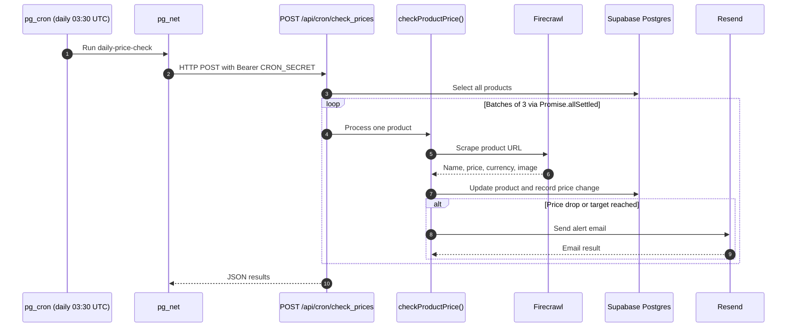
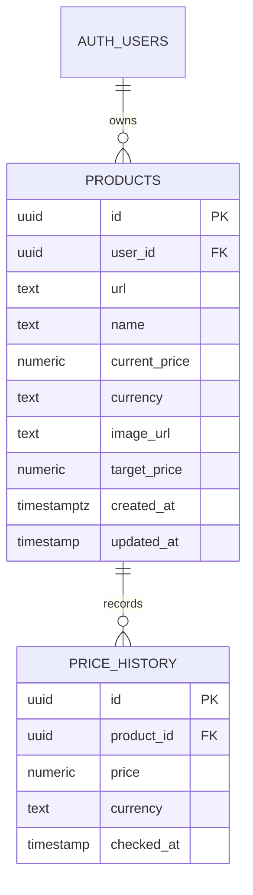

# DealDrop

<div align="center">

<h1>DealDrop</h1>

<p>Keep track of the prices you care about — track a product's price and get an email when it drops.</p>

[](https://deal-drop-x.vercel.app)
[](https://nextjs.org)
[](https://supabase.com)
[](https://tailwindcss.com)
[](https://firecrawl.dev)
[](https://resend.com)
[](https://vercel.com)
[](LICENSE)

**[Live demo](https://deal-drop-x.vercel.app)** · [Demo](#demo) · [Architecture](#architecture) · [Security](#security) · [Getting started](#getting-started)

</div>

## For reviewers

> The live demo supports Google sign-in and can be tried with a Google account.
> Add a product URL, optionally set a target price, and inspect the tracked-product workflow.

| Where to look | What it shows |
|---|---|
| [`app/api/cron/check_prices/route.js`](./app/api/cron/check_prices/route.js) | Bearer-secured batch endpoint |
| [`lib/priceCheck.js`](./lib/priceCheck.js) | Shared price-check and alert logic |
| [`supabase/schema.sql`](./supabase/schema.sql) | Tables and Row Level Security policies |
| [`app/share/[id]/`](./app/share/%5Bid%5D) | Public page and dynamic Open Graph image |
| [`lib/email.js`](./lib/email.js) | HTML-escaped alert email |
| [`app/auth/callback/route.js`](./app/auth/callback/route.js) | OAuth code exchange with a safe relative redirect |

## Demo

<table>
<tr>
<td align="center"><br><em>Dashboard with product URL tracking, target prices, and price-history cards.</em></td>
<td align="center"><br><em>Resend alert email for a price drop or reached target price.</em></td>
</tr>
</table>

## At a glance

| Daily schedule | Data model | Cron batching | Check Now cooldown | Cron route duration |
|---|---|---|---|---|
| 9:00 AM IST | 2 tables, 6 RLS policies | 3 products | 5 minutes | 300 seconds |

## Features

- **Track products by URL** — Firecrawl extracts the product name, current price, currency, and image; submitting the same URL again upserts the user's product.
- **Price history** — price changes are stored in `price_history` and displayed with an expandable Recharts chart.
- **Target-price alerts** — with a target, an alert is sent when `newPrice <= target_price`; without one, any price drop triggers an alert.
- **Automated daily checks** — Supabase `pg_cron` schedules a `pg_net` request at `03:30 UTC` (`09:00 AM IST`) to the secured cron route.
- **Check Now** — authenticated users can re-check one of their products, with a server-enforced five-minute cooldown.
- **Email alerts** — Resend sends formatted HTML notifications for price drops and reached targets.
- **Public share pages** — each product can be viewed without signing in, with a generated 1200×630 Open Graph image.
- **Google sign-in and data isolation** — Supabase Auth and Row Level Security scope tracked products and price history to the signed-in user.

## Architecture

Price monitoring runs server-side. Supabase schedules the cron request, the Next.js route processes products in batches, and the shared checker handles scraping, persistence, and alert delivery.





`checkProductPrice()` in [`lib/priceCheck.js`](./lib/priceCheck.js) is the single implementation for price refreshes. The cron route calls it with a service-role client, while the authenticated Check Now route calls it with the user's Supabase client. The shared function updates the product, records changed prices, resolves the recipient email through either the service-role admin API or the current session, and sends an alert when the configured rule matches.

## Engineering notes

- **Postgres-owned scheduling** — `pg_cron` and `pg_net` keep daily scheduling in Supabase; the request uses an explicit 60-second timeout because pg_net's default 5-second timeout is shorter than a scrape, and responses are inspectable in `net._http_response`.
- **One checker for two entry points** — cron and Check Now share `checkProductPrice()`, including recipient lookup for both service-role and user-session clients.
- **Append only on change** — `price_history` receives an entry for a new product or when the newly scraped price differs from the previous price.
- **Allowlisted public data** — share pages select only safe product columns and history fields, never `user_id`, `url`, or `target_price`.
- **Bounded work** — the cron route processes three products at a time with `Promise.allSettled`; the route declares a 300-second maximum duration.
- **Server-side alert rule** — a target price alerts at or below the target; without a target, any lower price alerts.
- **Server-side cooldown** — the five-minute Check Now limit is enforced by the API route; the client countdown is only presentation.

The cron SQL uses `timeout_milliseconds := 60000` so the request has time for a product scrape while remaining bounded. pg_net responses can be inspected through its HTTP response records when diagnosing scheduled requests.

## Security

- Six Row Level Security policies protect the two tables: four policies on `products` and two on `price_history`.
- The cron endpoint requires an exact `Authorization` bearer value matching `CRON_SECRET`.
- The Supabase service-role key is used by server-side cron and public-share data access, never by browser code.
- The OAuth callback accepts only same-site relative `next` paths and rejects protocol-relative or absolute redirect targets.
- Email interpolations are HTML-escaped before being inserted into the Resend message.
- Public share pages expose selected product and history fields without user identifiers, source URLs, or target prices.

## Tech stack

| Technology | Role |
|---|---|
| Next.js 16 | App Router, Server Actions, route handlers, and dynamic Open Graph image generation |
| React 19 | Client interactions and UI components |
| Supabase | Postgres, Google Auth, RLS, `pg_cron`, and `pg_net` |
| Firecrawl v4 SDK | Structured product-page extraction |
| Resend | Transactional price-alert email delivery |
| Tailwind CSS v4 | Styling and design tokens |
| Recharts | Interactive price-history charts |
| Base UI and Lucide | Accessible UI primitives and icons |

## Project structure

```text
dealdrop/
├── app/
│   ├── page.jsx
│   ├── actions.js
│   ├── layout.js
│   ├── globals.css
│   ├── api/
│   │   ├── cron/check_prices/route.js
│   │   └── products/[id]/check/route.js
│   ├── auth/
│   │   └── callback/route.js
│   ├── auth-error/page.jsx
│   └── share/[id]/
│       ├── page.jsx
│       └── opengraph-image.jsx
├── components/
│   ├── AddProductForm.jsx
│   ├── AuthButton.jsx
│   ├── AuthModal.js
│   ├── HowItWorks.jsx
│   ├── PriceChart.jsx
│   ├── ProductCard.jsx
│   └── ProductList.jsx
├── lib/
│   ├── content.js
│   ├── email.js
│   ├── firecrawl.js
│   ├── format.js
│   ├── priceCheck.js
│   └── publicProduct.js
├── public/
├── screenshot/
├── supabase/schema.sql
├── .env.example
└── package.json
```

<details id="getting-started">
<summary>Getting started</summary>

Clone and install:

```bash
git clone https://github.com/vivekcode12345/DealDrop.git
cd DealDrop
npm install
```

Create local environment variables:

```bash
cp .env.example .env.local
```

Run [`supabase/schema.sql`](./supabase/schema.sql) in the Supabase SQL Editor. Enable `pg_cron` and `pg_net`, then schedule the daily request with your deployed URL and `CRON_SECRET`:

```sql
select cron.schedule(
  'daily-price-check',
  '30 3 * * *',
  $$
  select net.http_post(
    url := 'https://<YOUR_DEPLOYED_URL>/api/cron/check_prices',
    headers := jsonb_build_object(
      'Authorization', 'Bearer <YOUR_CRON_SECRET>',
      'Content-Type', 'application/json'
    ),
    body := '{}'::jsonb,
    timeout_milliseconds := 60000
  ) as request_id;
  $$
);
```

The explicit 60-second timeout gives the scrape request more time than pg_net's default 5-second timeout.

In **Supabase Dashboard → Authentication → URL Configuration**, set the Site URL to your deployed application URL and add:

```text
https://<YOUR_DEPLOYED_URL>/auth/callback
http://localhost:3000/auth/callback
```

Start the development server:

```bash
npm run dev
```

Open [http://localhost:3000](http://localhost:3000).

</details>

<details>
<summary>Environment variables</summary>

| Variable | Purpose |
|---|---|
| `NEXT_PUBLIC_SUPABASE_URL` | Public API URL of the Supabase project |
| `NEXT_PUBLIC_SUPABASE_PUBLISHABLE_KEY` | Browser and server Supabase client key |
| `SUPABASE_SERVICE_ROLE_KEY` | Server-only key for cron and public-share reads |
| `FIRECRAWL_API_KEY` | Firecrawl API authentication |
| `RESEND_API_KEY` | Resend API authentication |
| `RESEND_FROM_EMAIL` | Sender address for price-alert emails |
| `NEXT_PUBLIC_APP_URL` | Deployed app URL used in email links |
| `CRON_SECRET` | Bearer secret for the cron endpoint |

</details>

## Roadmap

Ideas, not currently implemented:

- Add unit tests for the shared price-check and alert rules.
- Add retry and backoff handling for failed scrapes.
- Add a weekly digest email.
- Add per-user alert preferences.

## License

Licensed under the [MIT License](./LICENSE).

## Author

[Vivek Verma](https://github.com/vivekcode12345)

Listed in the [XERJ Corpus Hub](https://hub.xerj.org/corpus/vivekcode12345--dealdrop).
