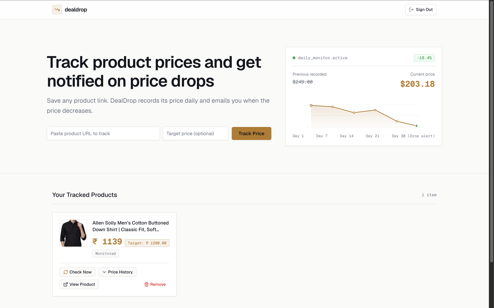
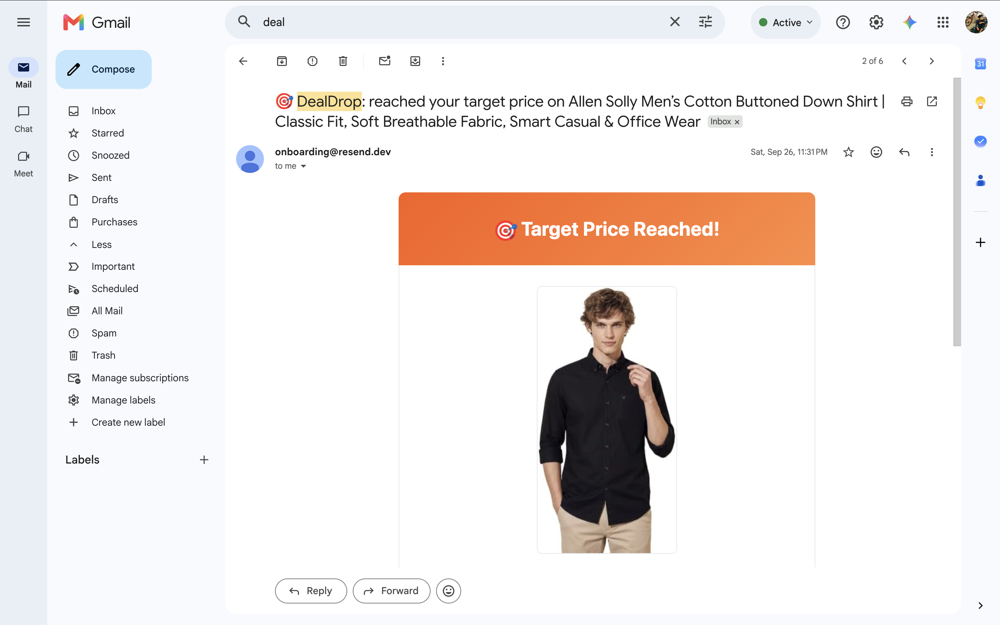
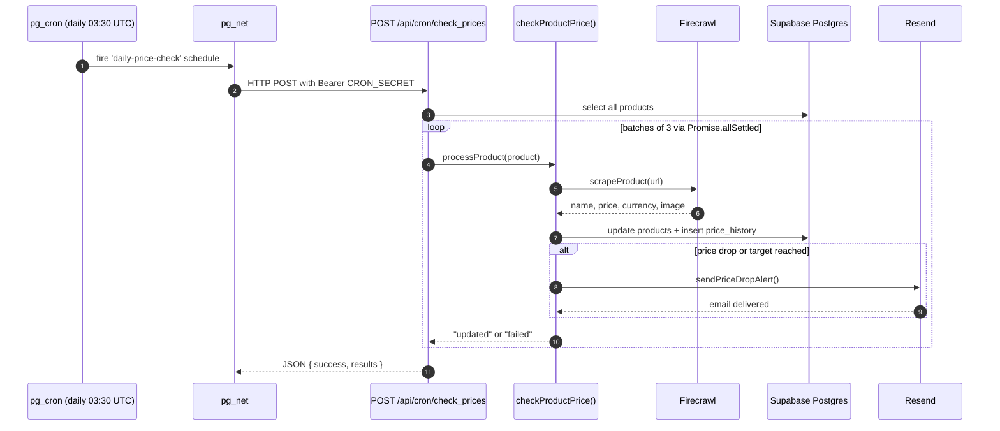

# DealDrop

Keep track of the prices you care about — track a product's price and get an email when it drops.

<div align="center">

[](https://get-deal-drop.vercel.app)
[](https://nextjs.org)
[](https://supabase.com)
[](https://tailwindcss.com)
[](https://firecrawl.dev)
[](https://resend.com)
[](LICENSE)

</div>

---

## Screenshots

<p align="center">
  
</p>
<p align="center"><em>The dashboard: paste a product URL, optionally set a target price, and every tracked product renders as a card with a one-click price-history chart.</em></p>

<p align="center">
  
</p>
<p align="center"><em>The alert email delivered via Resend when a tracked price drops — or when it reaches a set target price.</em></p>

---

## Highlights

- **2 Postgres tables** (`products`, `price_history`) — one source of truth for tracked items, one append-only log of every recorded price.
- **6 Row Level Security policies** — 4 on `products` (select/insert/update/delete scoped to `auth.uid()`) and 2 on `price_history` (select/insert gated by an `EXISTS` join back to the owning product).
- **Concurrency controlled to a batch of 3** — the cron route walks all products in chunks of 3 through `Promise.allSettled`, so one slow scrape can never stall the rest.
## Features

- **Track products by URL** — paste any product page link. [`scrapeProduct()`](./lib/firecrawl.js) extracts the product name, current price, currency code, and thumbnail as structured JSON. Re-submitting the same URL upserts it (unique on `user_id` + `url`) instead of creating a duplicate.
- **Price history charting** — every recorded price is appended to `price_history` and rendered on an interactive Recharts line chart, with the minimum, maximum, and start/end dates labeled.
- **Target-price alerts** — set an optional target price on a product. The alert fires when the scraped price falls to or below it (`newPrice <= target_price`), and the email reads "reached your target price" instead of the generic drop message.
- **Automated daily price checks** — Supabase `pg_cron` fires `pg_net` to POST to a secured Next.js route (`30 3 * * *`, 09:00 IST), which re-scrapes every tracked product.
- **On-demand "Check Now"** — any user can trigger an immediate single-product check from the card. Authenticated with the regular per-request Supabase client, so RLS restricts it to that user's own product, plus a 5-minute cooldown.
- **Email alerts via Resend** — a drop (or a reached target) sends a formatted HTML email. All interpolated values are HTML-escaped before injection.
- **Public share pages with dynamic OG images** — each product has a public read-only page plus a generated 1200×630 Open Graph card (product name, current price, and a sparkline) for rich link previews. A service-role client bypasses RLS here, exposing only the safe columns — never `user_id`, `url`, or `target_price`.
- **Authentication and data isolation** — sign in with Google via Supabase Auth. Every query is scoped by RLS, so users only ever see their own products and price records.

---

## Tech Stack

- **[Next.js 16](https://nextjs.org)** (App Router) — Server Actions, Route Handlers, `generateMetadata`, and file-convention OG image generation.
- **[Supabase](https://supabase.com)** — managed Postgres, Google OAuth, Row Level Security, and the `pg_cron` + `pg_net` scheduling pair.
- **[Firecrawl v4 SDK](https://firecrawl.dev)** (`@mendable/firecrawl-js`) — scraping engine with schema-driven JSON extraction.
- **[Resend](https://resend.com)** — transactional email API for the alert emails.
- **[Tailwind CSS v4](https://tailwindcss.com) + [Base UI](https://base-ui.com)** — styling driven by a `@theme` token palette in `globals.css`, with Base UI primitives (shadcn "base-nova") and Lucide icons.
- **[Recharts](https://recharts.org)** — the interactive price-history line chart.

---

- **Rate limited to 1 check per 5 minutes per product** — the on-demand "Check Now" button enforces a 300,000 ms cooldown client-side *and* re-checks it server-side, returning `429` if the request is too recent.

## Architecture

Price monitoring runs server-side and independently of any browser session — there is no client polling. Supabase's `pg_cron` fires on a schedule and `pg_net` issues an HTTP `POST` to `/api/cron/check_prices`, authorized by a `Bearer` secret (`CRON_SECRET`). That route walks products in batches of 3 and delegates each one to the shared `checkProductPrice()` function in `lib/priceCheck.js`, which scrapes, updates the row, appends to `price_history`, and sends an email when the alert condition holds. The exact same `checkProductPrice()` function also powers the on-demand "Check Now" endpoint — the only difference is authentication (a `Bearer` secret versus an authenticated per-request user client) and which products get processed.



---

## Project Structure

```
dealdrop/
├── app/
│   ├── page.jsx                          # Dashboard: hero, add-product form, product grid
│   ├── actions.js                        # Server actions: addProduct, deleteProduct, getProducts, getPriceHistory
│   ├── layout.js                         # Root layout, Geist fonts, root metadata
│   ├── globals.css                       # Tailwind v4 @theme design tokens (light palette)
│   ├── api/cron/check_prices/route.js    # Secured daily cron endpoint (Bearer CRON_SECRET)
│   ├── api/products/[id]/check/route.js  # Authenticated on-demand "Check Now" endpoint
│   ├── auth/callback/route.js            # Supabase OAuth code exchange
│   ├── auth-error/page.jsx               # Sign-in failure screen
│   └── share/[id]/
│       ├── page.jsx                      # Public read-only product page
│       └── opengraph-image.jsx           # Dynamic OG image (ImageResponse, 1200x630)
├── components/
│   ├── ProductCard.jsx                   # Product panel: Check Now, Share, chart toggle, remove
│   ├── AddProductForm.jsx                # URL + optional target price inputs
## Getting Started

### 1. Clone the repository

```bash
git clone https://github.com/vivekcode12345/DealDrop.git
cd DealDrop
```

### 2. Install dependencies

```bash
npm install
```

### 3. Configure environment variables

Copy the example environment file and populate the required keys:

```bash
cp .env.example .env.local
```

### 4. Set up the database schema

Run the SQL script located at [`supabase/schema.sql`](supabase/schema.sql) in your Supabase SQL Editor. This creates the `products` and `price_history` tables and the 6 Row Level Security policies.

### 5. Enable extensions and schedule the cron job

In your Supabase project dashboard:

1. Enable the `pg_cron` and `pg_net` extensions under **Database > Extensions**.
2. Run the scheduling script from [`supabase/schema.sql`](supabase/schema.sql), updating your deployed URL and `CRON_SECRET`:

```sql
select cron.schedule(
  'daily-price-check',
  '30 3 * * *', -- 9:00 AM IST
  $$
  select net.http_post(
    url := 'https://<YOUR_DEPLOYED_URL>/api/cron/check_prices',
    headers := jsonb_build_object(
      'Authorization', 'Bearer <YOUR_CRON_SECRET>',
      'Content-Type', 'application/json'
    ),
    body := '{}'::jsonb
  ) as request_id;
  $$
);
```

### 6. Run the local development server

```bash
npm run dev
```

Visit [http://localhost:3000](http://localhost:3000) in your browser.

---

## Environment Variables

| Variable | Purpose |
| --- | --- |
| `NEXT_PUBLIC_SUPABASE_URL` | Public API URL of your Supabase project instance |
| `NEXT_PUBLIC_SUPABASE_PUBLISHABLE_KEY` | Public client publishable API key for Supabase client initialization |
| `SUPABASE_SERVICE_ROLE_KEY` | Elevated service-role key that bypasses RLS. Used by the cron job **and** by the public share pages, so only a fixed set of safe columns is ever selected there |
| `FIRECRAWL_API_KEY` | API authentication key for Firecrawl v4 scraping service |
| `RESEND_API_KEY` | API authentication key for Resend email service |
| `RESEND_FROM_EMAIL` | Verified sender email address used for price drop notification emails |
| `NEXT_PUBLIC_APP_URL` | Public URL of the deployed application (used for email deep-links) |
| `CRON_SECRET` | Secret bearer token required to authorize incoming requests to `/api/cron/check_prices` |

---

## License

This project is licensed under the [MIT License](LICENSE).

---

## Author

Built by **[Vivek Verma](https://github.com/vivekcode12345)**

│   ├── PriceChart.jsx                    # Recharts price-history chart
│   ├── AuthButton.jsx / AuthModal.js     # Supabase Google OAuth sign-in UI
│   └── Footer.jsx
├── lib/
│   ├── priceCheck.js                     # Shared scrape/update/alert logic (cron + on-demand)
│   ├── publicProduct.js                  # Service-role read for public share pages
│   ├── firecrawl.js                      # Firecrawl v4 structured JSON extraction
│   ├── email.js                          # Resend alert email template
│   └── content.js                        # Single source of truth for UI copy
├── supabase/
│   └── schema.sql                        # Tables, 6 RLS policies, pg_cron schedule
├── screenshot/                           # README images
└── proxy.js                              # Middleware session refresh
```

---

---
